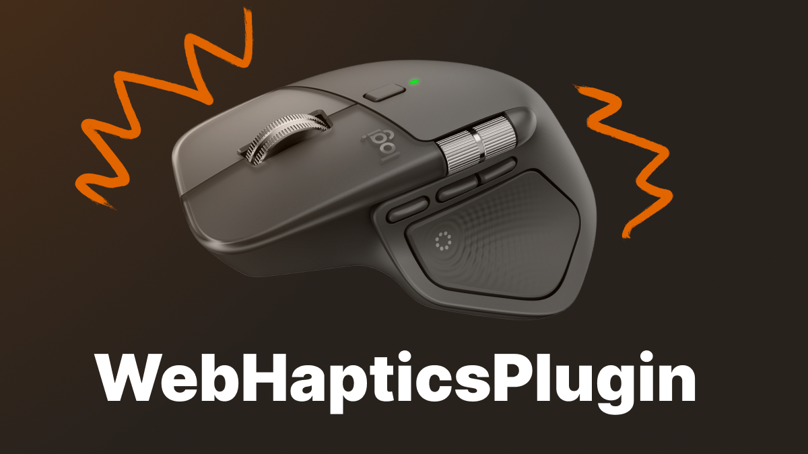

<h1 align="center">
  <br>
  <a href="https://haptics.jmw.nz" target="_blank">
    
  </a>
</h1>


A Logi Actions SDK plugin that exposes MX Master 4 haptic feedback via a local HTTP server and WebSocket API.

## Requirements

- Logitech MX Master 4 mouse
- Logi Options+ installed
- Logi Plugin Service running

## API Server

The plugin runs an HTTP server on `http://127.0.0.1:41080/` when loaded. Chrome and Firefox treat loopback as a secure context, so HTTPS pages can call it directly (Safari: see the HTTPS fallback below).

### Which websites can use it

Like phone vibration on the web, any website you visit can trigger haptics and detect that the plugin is running. Chrome asks for your permission before a site can connect to local services. The server only accepts connections from this computer.

### HTTPS fallback for Safari (deprecated)

Safari still blocks plain `http://`/`ws://` requests to localhost from HTTPS pages, so the plugin also serves the same API on `https://local.jmw.nz:41443/`. `local.jmw.nz` resolves to `127.0.0.1`, and the certificate is downloaded from GitHub and cached locally; the plugin checks for a new one when it starts (at most once a day).

This fallback will be removed once Safari allows loopback requests, or by November 2027 at the latest. Try `http://127.0.0.1:41080` first and fall back to it only when that fails (see `web-demo/src/lib/haptics-ws.ts`).

### REST API Endpoints

| Endpoint | Method | Description |
|----------|--------|-------------|
| `/` | GET | Health check (`{"success": true, "service": "HapticWebPlugin"}`) |
| `/waveforms` | GET | List all 15 available haptic waveforms |
| `/haptic/{waveform}` | POST | Trigger a specific haptic waveform |

### WebSocket API

**Endpoint:** `ws://127.0.0.1:41080/ws` (Safari: `wss://local.jmw.nz:41443/ws`)

Keeps a warm connection for theoritically lower latency.

**Protocol:**
- Send a single byte containing the waveform index (0-14)
- No response is sent back
- Connection stays open for repeated triggers
- Messages larger than 1 KB (or frames over 125 bytes) close the connection

### Available Waveforms

The plugin supports 15 haptic waveforms across different categories:

| Waveform | Index | Category |
|----------|-------|----------|
| `sharp_collision` | 0 | Precision enhancers |
| `sharp_state_change` | 1 | Progress indicators |
| `knock` | 2 | Incoming events |
| `damp_collision` | 3 | Precision enhancers |
| `mad` | 4 | Progress indicators |
| `ringing` | 5 | Incoming events |
| `subtle_collision` | 6 | Precision enhancers |
| `completed` | 7 | Progress indicators |
| `jingle` | 8 | Incoming events |
| `damp_state_change` | 9 | Precision enhancers |
| `firework` | 10 | Progress indicators |
| `happy_alert` | 11 | Progress indicators |
| `wave` | 12 | Progress indicators |
| `angry_alert` | 13 | Progress indicators |
| `square` | 14 | Progress indicators |

## Example Usage

### HTTP REST API

```bash
# Health check
curl http://127.0.0.1:41080/

# List all available waveforms
curl http://127.0.0.1:41080/waveforms

# Trigger haptic feedback (note: -d '' is required to send Content-Length header)
curl -X POST -d '' http://127.0.0.1:41080/haptic/sharp_collision
curl -X POST -d '' http://127.0.0.1:41080/haptic/happy_alert
curl -X POST -d '' http://127.0.0.1:41080/haptic/completed
# {
#   "success": true,
#   "waveform": "completed"
# }

```

> **Note:** POST requests require a `Content-Length` header. When using curl, include `-d ''` to send an empty body with the proper header otherwise the request will hang. I have some *thoughts* about this design choice by the otherwise great NetCoreServer library.

### WebSocket API (JavaScript)

```javascript
// Connect to WebSocket (Safari: 'wss://local.jmw.nz:41443/ws', deprecated)
const ws = new WebSocket('ws://127.0.0.1:41080/ws');

ws.onopen = () => {
  console.log('Connected to HapticWeb');
  
  // Trigger "sharp_collision" (index 0)
  ws.send(new Uint8Array([0]));
  
  // Trigger "completed" (index 7)
  ws.send(new Uint8Array([7]));
  
  // Trigger "happy_alert" (index 11)
  ws.send(new Uint8Array([11]));
};

ws.onclose = () => console.log('Disconnected');
ws.onerror = (err) => console.error('WebSocket error:', err);
```


## Technical Details

### Architecture
- **Server:** NetCoreServer-based HTTP/WS, plus HTTPS/WSS fallback
- **Ports:** 41080 (HTTP), 41443 (HTTPS fallback for Safari, deprecated)
- **CORS:** Enabled, any origin
- **Binding:** `127.0.0.1` only
- **Limits:** 16 KB per HTTP request, 1 KB per WebSocket message

### Certificate Management (HTTPS fallback only)
- Downloads from the GitHub `certs` branch on first run
- Cached locally in plugin data directory
- Checks for a new certificate on startup, at most once every 24 hours
- Warns 14 days before expiry
- Falls back to cache if GitHub is unreachable

## Installation

Install from the [Logitech Marketplace](https://marketplace.logi.com/plugin/HapticWeb/en) directly within Logi Options+. You can find plugins in the Haptic Feedback area of your MX Master 4 settings.

### Manual Installation

1. Open Logitech Options+ and click on your MX Master 4.
2. In the left sidebar, open the `HAPTIC FEEDBACK` tab and click on the haptic feedback settings popover.
3. In the new right sidebar, click the `INSTALL AND UNINSTALL PLUGINS` button.
4. Download the `HapticWeb.lplug4` release asset from [GitHub Releases](https://github.com/fallstop/HapticWebPlugin/releases) and double-click it.
5. This will trigger an installation dialog in Logitech Options+. Press continue.
6. The server starts automatically at `http://127.0.0.1:41080/`
7. Test at [https://haptics.jmw.nz](https://haptics.jmw.nz)

## Development

### Building
```bash
# Debug build (auto-reloads in Logi Plugin Service)
dotnet build -c Debug

# Release build
dotnet build -c Release
```

### Packaging & Distribution
```bash
# Create plugin package
logiplugintool pack ./bin/Release ./HapticWeb.lplug4

# Install locally
logiplugintool install ./HapticWeb.lplug4

# Uninstall
logiplugintool uninstall HapticWeb
```

### Testing
- **Manual testing:** Use the demo site at [https://haptics.jmw.nz](https://haptics.jmw.nz)
- **CLI testing:** Use curl commands shown in [Example Usage](#example-usage)
- **Live reload:** Debug builds auto-reload when the plugin is rebuilt

## Troubleshooting

### Certificate Issues (Safari / HTTPS fallback only)
If you see certificate errors:
1. Check plugin status in Logi Options+ (should show green "Normal")
2. Verify internet connection (initial certificate download requires network)
3. Restart Logi Plugin Service
4. Report an issue with the plugin logs if the problem persists

### Port Already in Use
If port 41080 (or 41443 for the HTTPS fallback) is in use:
1. Stop other services using that port, e.g. `lsof -ti:41080 | xargs kill -9` (macOS/Linux; use 41443 for the fallback)
2. Restart Logi Plugin Service

### WebSocket Connection Failed
If WebSocket connections fail:
1. Verify the server is running: `curl http://127.0.0.1:41080/`
2. Check browser console for errors
3. In Chrome, allow the local network access prompt
4. In Safari, use the HTTPS fallback `wss://local.jmw.nz:41443/ws` and verify `local.jmw.nz` resolves to `127.0.0.1`: `ping local.jmw.nz`

## MIT License

See [LICENSE.md](LICENSE.md) for details.